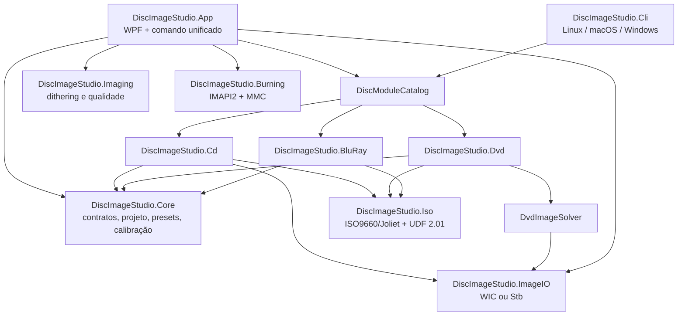

# Arquitetura e limites

[← Índice](README.md) · [Telas e UX →](02-ui-ux.md)

## Visão arquitetural

O projeto combina uma arquitetura modular por mídia com uma aplicação desktop MVVM. O ponto de integração é `DiscImageStudio.Core`: ele define contratos, documentos de projeto, presets, geometria comum e calibração, mas não conhece WPF, IMAPI ou os motores concretos.

Essa estrutura é adequada ao problema. CD, DVD e BD-R não compartilham a mesma modulação, organização de setores, correção de erros ou estratégia de gravação. O código corretamente compartilha o ciclo de aplicação e mantém os detalhes físicos em módulos separados.

## Inventário dos projetos

| Projeto | Responsabilidade | Alvo principal | Observação |
| --- | --- | --- | --- |
| `DiscImageStudio.Core` | Contratos, catálogo, projeto, presets, tom, geometria e calibração | `net10.0` | É o núcleo mais estável e não depende de UI. |
| `DiscImageStudio.ImageIO` | Leitura/escrita raster | `net10.0` e Windows | WIC no desktop e Stb nos alvos portáveis. |
| `DiscImageStudio.Imaging` | Dithering e constantes de qualidade | Windows/WPF | Pequeno, mas ainda acoplado ao WPF. |
| `DiscImageStudio.Iso` | ISO9660/Joliet e UDF 2.01 sequenciais | `net10.0` | Não depende da aplicação. |
| `DiscImageStudio.Cd` | Geometria, amostragem, CD-DA e CD de dados | Portável + Windows | Usa ISO9660/Joliet no modo de dados. |
| `DvdImageSolver` | Encoder, solver e executável histórico de DVD | Windows | Contém o motor e self-tests próprios. |
| `DiscImageStudio.Dvd` | Adaptador modular e geração sequencial/híbrida | Portável + Windows | Hospeda o solver de duas maneiras conforme o target. |
| `DiscImageStudio.BluRay` | Geometria BD-R, 17PP, ECC, mapeamento 3T/6T e UDF | `net10.0` | Implementação experimental de camada única. |
| `DiscImageStudio.Burning` | Dispositivos, sessões, buffering e gravação | Windows | IMAPI2 para CD/DVD e comandos MMC para BD-R. |
| `DiscImageStudio.App` | Shell WPF, telas, ViewModels, serviços e CLI Windows | Windows | Maior concentração de código de produção. |
| `DiscImageStudio.Cli` | CLI portável | `net10.0` | Compartilha catálogo e módulos com o desktop. |
| `ArchitectureTests` | Harness de regressão | Windows/WPF | Executável próprio, não usa framework de testes. |
| `FourLevelDither` | Ferramenta visual de dithering | Windows/WPF | Ferramenta de pesquisa/desenvolvimento. |
| `DvdGrayProbe` | Sonda de tons do DVD | Windows/WPF | Validação do modelo do DVD. |
| `BluRayByteProbe` | Experimentos de densidade e padrões BD | `net10.0` | Reproduz análises físicas documentadas. |

## Contrato modular

O contrato em `OpticalDiscContracts.cs` é deliberadamente pequeno:

- `IOpticalDiscModule` expõe descritor e execução assíncrona;
- `DiscModuleDescriptor` e `DiscCommandDescriptor` descrevem capacidades e opções;
- `DiscJobRequest` transporta comando e argumentos;
- `DiscJobProgress` normaliza progresso, estágio, unidades e tempo;
- `DiscJobResult` normaliza saída e código de retorno;
- `DiscModuleCatalog` valida IDs/comandos duplicados e roteia a execução.

O desenho é extensível e evita dependência da UI nos internals dos motores. Há, contudo, uma tensão arquitetural: as opções possuem metadados tipados no descritor, mas a execução recebe `IReadOnlyList<string>`. A GUI constrói manualmente argumentos como `--r0`, `--tone-dither` e `--file-position`. Isso traz três custos:

1. validação e defaults podem divergir entre tela e módulo;
2. renomear uma opção não é refatoração segura;
3. a camada de aplicação conhece detalhes de sintaxe de cada CLI.

O contrato atual é bom como fronteira externa. Para chamadas internas, faltam requests tipados — por exemplo, `CdGenerateRequest`, `DvdGenerateRequest` e `BluRayGenerateRequest` — adaptados para a CLI apenas na borda.

## Composição e injeção de dependências

A composição é manual e simples:

- `AppHost` carrega configurações, localização e tema;
- `MainWindow` cria `ShellViewModel`;
- `ShellViewModel` cria o estado e todos os ViewModels filhos;
- `ConsoleModuleRunner` cria o catálogo estático com os três módulos;
- `WindowsImapiBurner` é injetável em construtores internos para testes.

Essa solução evita um contêiner de DI desnecessário e facilita seguir o fluxo. Ao mesmo tempo, o `ShellViewModel` virou composition root, coordenador de navegação, sessão de projeto, jobs, logs, notificações e estado global. A recomendação não é introduzir um framework de DI por si só, e sim extrair serviços de caso de uso (`ProjectService`, `JobCoordinator`, `NavigationService`) e manter a composição explícita.

## Limites por família de mídia

### CD

O módulo possui dois modos reais:

- áudio: gera WAV ou RAW em setores de 2352 bytes, com CUE opcional e interleaving CDDA;
- dados: gera ISO Mode 1 com ISO9660/Joliet e área desenhada.

O projeto trata explicitamente byte order e a diferença entre arquivo e IMAPI. Essa precisão é um ponto forte: o pipeline não delega silenciosamente ao gravador uma conversão que não é garantida.

### DVD

`DiscImageStudio.Dvd` é uma fachada sobre o solver existente. Em Windows, referencia `DvdImageSolver` como projeto; em `net10.0`, inclui os fontes do solver com `Compile Include`. Isso preserva o executável histórico e habilita a CLI portável, mas cria dois modelos de hospedagem para o mesmo motor.

O efeito não é duplicar o solver dentro do mesmo target, pois os `ItemGroup` são condicionais. A dívida é de evolução: a identidade do motor depende do target, o projeto executável também funciona como biblioteca, e mudanças no glob de fontes podem afetar a versão portável. O destino ideal é `DiscImageStudio.Dvd.Engine` como biblioteca portável, referenciada pelo executável legado e pelo módulo.

### Blu-ray

O módulo contém a cadeia mais explicitamente experimental: scrambling, EDC, LDC/BIS, Reed-Solomon, 17PP, controle de DC, geometria e mapeamento por viés de runs 3T/6T. A separação entre `ToneProfile` e polaridade 3T/6T é correta: uma controla quantização visual; a outra, a classe física usada para representar claro/escuro.

Com arquivos, o volume gerado é UDF 2.01. Sem arquivos, o resultado ocupa a área de usuário com desenho e não é necessariamente um filesystem montável. O limite atual é BD-R de camada única; remapeamento de spare area não faz parte da implementação.

## Filesystems e escrita sequencial

`DiscImageStudio.Iso` fornece planejadores e escritores forward-only. Essa é uma decisão arquitetural importante porque permite:

- exportar imagens grandes sem manter todo o conteúdo em memória;
- alimentar diretamente a gravação sem criar um arquivo intermediário completo;
- posicionar arquivos no anel interno ou externo;
- validar extents antes de iniciar a escrita física.

CD/DVD de dados usam ISO9660/Joliet. BD-R usa UDF 2.01. Os planejadores guardam metadados e posições, não o conteúdo integral dos arquivos.

## Persistência e schemas

O arquivo `.discproj` é um documento JSON versionado. Ele persiste geometria, camadas, saída, tom, configuração BD, caminho da calibração e thumbnail. A implementação usa:

- rejeição de membros desconhecidos, exceto uma chave legada explícita;
- validação tanto ao carregar quanto ao salvar;
- leitura compatível do schema anterior;
- escrita formatada via arquivo temporário e substituição;
- limites de tamanho para thumbnail.

Presets e configurações adotam princípios semelhantes. O ponto fraco funcional é a portabilidade do projeto: imagens das camadas continuam referenciadas por caminhos absolutos. Mover o `.discproj` para outra máquina ou reorganizar a pasta quebra os assets, mesmo que o JSON permaneça íntegro.

## Concorrência, cancelamento e lifecycle

Os jobs pesados saem da thread da UI por `StaWorker`, importante porque parte do pipeline usa objetos WPF que exigem STA. O shell possui um gate de tarefa global, e a gravação possui gate próprio para impedir operações concorrentes no hardware.

Na gravação, `GeneratedContentComStream` conecta produtor e IMAPI com um canal limitado, chunks de 64 KiB e pré-buffer. Isso impõe backpressure e reduz o risco de underrun sem consumir memória proporcional ao tamanho da imagem. Sessões e objetos COM são liberados em blocos controlados, e a implementação de BD acompanha aquisições e tentativas de cleanup.

O cancelamento é cooperativo. Depois de um comando aceito pelo dispositivo, não há rollback físico; a UI comunica corretamente que uma saída parcial ou mídia inutilizável pode permanecer.

## O que está arquiteturalmente bem resolvido

- limites de domínio seguem diferenças físicas reais;
- Core não depende da GUI nem dos motores concretos;
- os mesmos módulos atendem desktop e CLI;
- arquivos grandes são gerados de forma sequencial;
- persistência tem schema, validação e escrita atômica;
- gravação está atrás de contratos testáveis;
- perfil tonal é compartilhado sem misturar polaridade específica do BD;
- ferramentas experimentais ficam fora da aplicação principal.

## Onde a arquitetura pede evolução

- requests internos tipados em vez de argumentos CLI textuais;
- extração do motor de DVD para biblioteca própria;
- decomposição do `ShellViewModel` e de ViewModels com mais de 800–1.600 linhas;
- estado de parâmetros tipado por mídia, com parsing apenas na borda da UI;
- projetos de teste portáveis para Core/ISO/motores e projeto Windows separado para WPF/IMAPI;
- empacotamento opcional dos assets ou resolução relativa no `.discproj`.

---

[← Índice](README.md) · [Telas e UX →](02-ui-ux.md)
