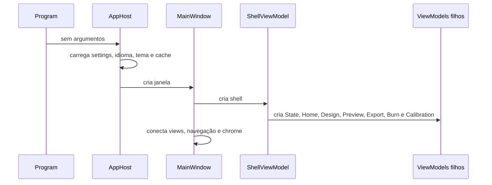
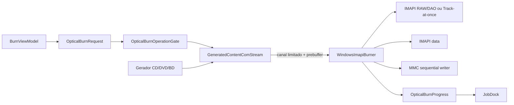

# Código e fluxos de dados

[← Telas e UX](02-ui-ux.md) · [Índice](README.md) · [Qualidade e operação →](04-quality-and-operations.md)

## Ciclo de vida da aplicação



Com argumentos, o executável WPF anexa ao console pai e encaminha ao `UnifiedCommandRunner`. A CLI portável usa o mesmo `ConsoleModuleRunner`, portanto os comandos de mídia não são reimplementados.

## Estado compartilhado

`DiscParametersState` é a memória operacional da sessão. Ele contém campos de CD, DVD e BD, geometria gerada e medida, caminhos, formato, posição de arquivos, presets e perfil tonal.

Vantagens:

- todas as telas observam a mesma fonte;
- abrir/salvar um projeto tem uma ponte explícita em `ProjectSession`;
- Preview, Export e Burn não mantêm cópias divergentes;
- presets e calibração atualizam imediatamente os consumidores.

Custos:

- são cerca de 700 linhas e dezenas de propriedades;
- muitos números ficam como `string` para binding direto;
- parsing e mensagens de validação aparecem em vários casos de uso;
- propriedades de três famílias coexistem mesmo quando só uma está ativa;
- alterações de uma tela podem disparar observers amplos no shell.

Uma evolução segura seria separar `CdProjectState`, `DvdProjectState`, `BluRayProjectState`, `PreviewState` e `ToneState`, reunidos por um `ProjectWorkspaceState`. Campos editáveis podem continuar textuais em adapters de formulário, enquanto o estado validado usa tipos numéricos.

## Fluxo do projeto

```mermaid
flowchart LR
    JSON[.discproj] --> Load[ProjectJsonStore.Load]
    Load --> Validate[Validação de schema e invariantes]
    Validate --> Apply[ProjectSession.ApplyToState]
    Apply --> State[DiscParametersState]
    State --> Views[Design / Preview / Export / Burn / Calibration]
    Views --> Dirty[Shell marca dirty]
    Dirty --> Capture[CaptureGeometry / Outputs / Tone / BluRay]
    Capture --> Thumb[Renderiza thumbnail]
    Thumb --> Save[Escrita atômica do .discproj]
```



Camadas são armazenadas de baixo para cima no documento e apresentadas no painel em ordem inversa, mantendo pintura e expectativa visual coerentes. O thumbnail é Base64 dentro do projeto; imagens originais permanecem externas por caminho absoluto.

## Composição visual

O `DesignViewModel` mantém a coleção de camadas e uma revisão do composite. Edições são debounced por aproximadamente 450 ms. `DesignComposer` usa `DrawingVisual` e `RenderTargetBitmap` em STA:

- preview do Design: 2.048 px;
- geração/exportação: 8.192 px;
- thumbnail: 256 px;
- imagens de camada são decodificadas com limite de 4.096 px e congeladas para leitura cross-thread.

A composição é transparente e quadrada; o centro corresponde ao centro físico do disco. O pipeline de cada mídia faz a amostragem/anulação fora do anel útil. O cache evita renderizar novamente a versão de exportação enquanto a revisão não muda.

## Geração por mídia

### CD de áudio

```text
composite → tone/dither → amostragem da espiral → setores CD-DA
          → interleaving opcional → WAV little-endian ou RAW big-endian
          → CUE/metadata opcional
```

Na gravação, o produtor entrega PCM little-endian sem header ao adaptador IMAPI. Essa diferença em relação ao RAW histórico é explícita e testada.

### CD de dados

```text
pasta + composite → plano ISO9660/Joliet → setores Mode 1
                   → filesystem no anel escolhido + desenho na área restante
                   → .iso ou fluxo para gravação DAO
```

### DVD

```text
composite → tone binário → mapeamento geométrico por setor
          → constraint/dispersion solver → data frames + ECC + EFMPlus
          → ISO completo ou plano híbrido ISO9660/Joliet
          → arquivo ou fluxo de 2048 bytes/setor
```

O modelo aceita pitch cúbico em função do raio. O modo rápido e sequencial é o caminho produtivo; o executável histórico preserva algoritmos e self-tests adicionais.

### BD-R

```text
composite → quantização binária → posição física do payload
          → escolha 3T/6T + compensação do scrambler
          → setores de usuário / UDF 2.01 opcional
          → arquivo .iso + sidecar ou fluxo MMC sequencial
```

O nome `.iso` é usado como imagem de disco, mas o filesystem com arquivos é UDF 2.01. O mapping não promete que “3T” seja opticamente escuro em todo conjunto de mídia/gravador; a polaridade é configurável e calibrável.

## A fronteira stringly typed da aplicação

`ExportViewModel` não chama requests de domínio. Ele monta arrays como:

```text
solve --image ... --iso-output ... --total-sectors ...
bd-generate --input ... --output ... --r0 ... --invert ...
```

O shell então resolve o módulo e executa esses argumentos em STA. O caminho garante paridade com a CLI, mas transforma detalhes de parsing em uma API interna. `BurnViewModel`, por outro lado, chama geradores tipados diretamente para construir `OpticalBurnRequest`. Assim, existem duas formas de integração:

- exportação: GUI → argumentos CLI → módulo → motor;
- gravação: GUI → tipos concretos → motor → burner.

Essa assimetria aumenta a chance de exportar e gravar com opções diferentes. Hoje o código trabalha ativamente para manter a paridade, inclusive usando o mesmo composite de 8.192 px. Um `GenerationService` tipado, usado por Export e Burn e adaptado pela CLI, eliminaria a duplicação de montagem.

## Prévia

O `LivePreviewViewModel` é o maior arquivo da aplicação, com cerca de 1.697 linhas. Ele implementa pelo menos seis caminhos relevantes:

- projeção de Design para CD;
- readback de trilha CD;
- projeção/calibração de DVD;
- readback de ISO DVD;
- projeção de BD;
- readback de BD com sidecar.

Há cancelamento por revisão para descartar resultados antigos, parsing de metadata, exportação do PNG e status. A funcionalidade é coerente, mas o tamanho mostra que “Preview” é um agregado de casos de uso diferentes. Recomenda-se extrair renderers por família e modo, todos retornando um `PreviewResult` comum.

## Gravação em streaming



`GeneratedContentComStream` é um adapter COM forward-only. O produtor roda em background e publica chunks em um channel bounded; o consumidor bloqueia conforme IMAPI solicita dados. A capacidade padrão documentada é 64 MiB, com pré-buffer de 32 MiB.

O modelo é apropriado para imagens de até 25 GB: memória é limitada e não há arquivo temporário completo. O custo é que qualquer produtor mais lento que a gravação pode comprometer a mídia; por isso prebuffer, velocidade conservadora e telemetria são partes funcionais, não apenas otimizações.

## Calibração

O pipeline de calibração conecta Core, serviços de imagem e UI:

1. `CalibrationTarget` captura os parâmetros usados para gerar o disco;
2. a saída e o `.calibration.json` são publicados de forma transacional;
3. a fotografia é reduzida e embutida na sessão;
4. `CalibrationPhotoRectifier` ajusta as duas elipses concêntricas projetadas;
5. pontos de uma única curva radial são ordenados pelo raio;
6. fitters procuram raios e, no DVD, coeficientes de pitch;
7. candidatos trazem resíduos e curva prevista;
8. somente um candidato visualmente confirmado pode ser aplicado ao estado do projeto.

É um desenho responsável: o resultado não é aplicado automaticamente só porque o solver convergiu.

## Persistência auxiliar

| Artefato | Finalidade |
| --- | --- |
| `.discproj` | Documento do projeto e thumbnail. |
| `disc-presets.json` | Presets do usuário sobre catálogo embutido. |
| `settings.json` | Tema, idioma e diretórios locais. |
| `.calibration.json` | Snapshot de geração, foto, contornos e pontos. |
| sidecar de CD/DVD/BD | Geometria, tom, range desenhado e contexto para readback. |
| cache | composites e previews regeneráveis. |

`TempFiles` usa uma lista permitida de nomes ao limpar o cache e não remove diretórios ou exports. `CalibrationOutputPublisher` usa arquivos temporários/backups e tenta rollback de publicações múltiplas.

## Tratamento de erros e progresso

Os módulos retornam resultado normalizado, mas exceções de validação ainda são o mecanismo dominante. O shell converte falhas em toast, status e log. Jobs de mídia expõem progresso; renderizações menores usam estados locais.

Pontos positivos:

- cancelamento tem semântica explícita por módulo;
- exceções esperadas de IO/JSON são filtradas em stores;
- jobs têm gate global;
- revisões evitam publicar previews obsoletos;
- erros de gravação preservam diagnóstico de cleanup.

Pontos a melhorar:

- `RunDiscJobAsync` registra apenas `exception.Message` no log em alguns caminhos, perdendo stack/contexto;
- saída parcial após cancelamento é assumida e comunicada, mas não há política única de nome temporário + commit para todos os geradores;
- códigos de erro tipados permitiriam mensagens localizadas sem analisar texto de exceção;
- logs estruturados ajudariam a correlacionar módulo, fase, mídia e dispositivo.

## Pontos de concentração

| Arquivo | Linhas aproximadas | Responsabilidades acumuladas |
| --- | ---: | --- |
| `LivePreviewViewModel.cs` | 1.697 | seis pipelines, metadata, estado e exportação. |
| `ShellViewModel.cs` | 1.245 | sessão, navegação, jobs, dock, log, toast e arquivos. |
| `MainWindow.xaml.cs` | 905 | chrome, snapshots, settings, layout, navegação e animação. |
| `BurnViewModel.cs` | 892 | dispositivos, velocidade, requests de três mídias e lifecycle. |
| `CalibrationViewModel.cs` | 891 | wizard, geração, fitting, sessão e aplicação. |
| `ProjectDialogViewModel.cs` | 925 | templates, geometria, arquivo, presets e confirmação. |

Arquivos grandes não são defeito isoladamente; aqui eles refletem casos de uso naturalmente complexos. O sinal de refatoração é a multiplicidade de motivos para mudar. A divisão deve seguir mídia/caso de uso, não apenas criar classes menores arbitrárias.

---

[← Telas e UX](02-ui-ux.md) · [Índice](README.md) · [Qualidade e operação →](04-quality-and-operations.md)
