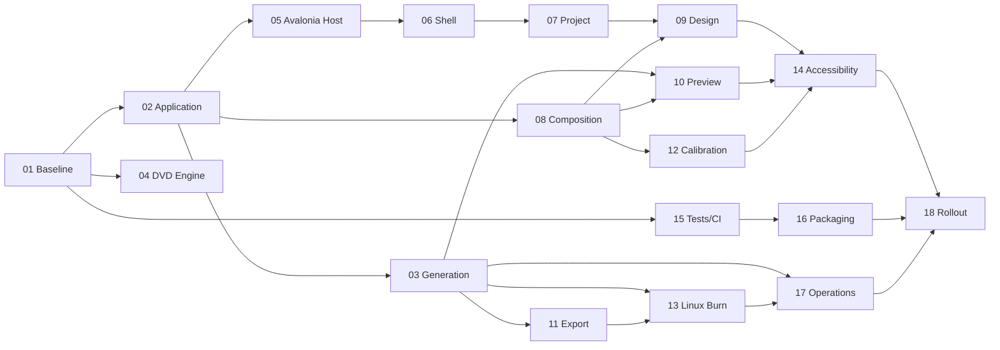

# Backlog da GUI Linux/Avalonia

[← Análise geral](../README.md) · [Primeira task →](01.architecture-baseline.md)

## Objetivo

Este backlog transforma a análise do projeto em uma sequência executável para entregar uma GUI nativa em Avalonia no Linux, inicialmente validada no Fedora. A implementação deve reutilizar os motores portáveis existentes, preservar a aplicação WPF e melhorar as fronteiras que hoje acoplam interface, CLI, composição de imagem e gravação.

Cada arquivo representa uma task entregável por Pull Request. Tasks maiores possuem marcos internos, mas não devem ser implementadas em um único PR quando isso impedir revisão, comparação de artefatos ou rollback seguro.

## Princípios obrigatórios

- `DiscImageStudio.Core`, motores e casos de uso não podem depender de Avalonia, WPF ou APIs do sistema operacional.
- A aplicação Avalonia não deve referenciar `DiscImageStudio.App`, `DiscImageStudio.Imaging` nem o projeto Windows de gravação.
- CLI, Exportação e Gravação devem convergir para requests e planos tipados; parsing textual fica somente na borda da CLI.
- O formato `.discproj` deve continuar compatível com a aplicação WPF durante a migração.
- A primeira entrega Linux não depende da gravação física: geração, projeto, Design, Prévia, Exportação e Calibração devem funcionar sem acesso ao dispositivo.
- Gravação Linux deve ser ativada por capability detection e nunca exigir execução da GUI como `root`.
- Operações longas precisam de progresso, cancelamento, saída transacional e diagnóstico suficiente para suporte.
- Cada task deve atualizar testes e documentação na mesma entrega.

## Ordem recomendada

| Task | Resultado principal | Prioridade | Dependências |
| --- | --- | --- | --- |
| [01](01.architecture-baseline.md) | Baseline e regras arquiteturais automatizadas | P0 | — |
| [02](02.portable-application-layer.md) | Casos de uso e estado fora das GUIs | P0 | 01 |
| [03](03.typed-generation-pipeline.md) | Geração tipada compartilhada por CLI/UI/Burn | P0 | 02 |
| [04](04.dvd-engine-extraction.md) | Um único assembly portátil para o motor DVD | P1 | 01 |
| [05](05.avalonia-host-and-platform-services.md) | Host Avalonia e serviços Linux/XDG | P0 | 01, 02 |
| [06](06.design-system-shell-and-navigation.md) | Shell, tema, navegação e feedback global | P0 | 05 |
| [07](07.project-lifecycle-and-home.md) | Home, projeto, recentes, relink e dirty state | P0 | 02, 05, 06 |
| [08](08.portable-image-composition.md) | Compositor de imagens independente de WPF | P0 | 01, 02 |
| [09](09.design-workspace-and-undo-redo.md) | Editor visual completo com histórico | P0 | 06, 07, 08 |
| [10](10.preview-and-readback.md) | Projeção e leitura de artefatos por mídia | P1 | 03, 08, 09 |
| [11](11.export-and-artifact-integrity.md) | Exportação transacional e validável | P0 | 03, 07, 08 |
| [12](12.calibration-workflow.md) | Calibração portátil em três etapas | P1 | 07, 08, 09 |
| [13](13.linux-burning-backend.md) | Abstrações e backend de gravação Linux | P1/P2 | 03, 05, 11 |
| [14](14.accessibility-localization-and-input.md) | Teclado, AT-SPI, DPI e sete idiomas | P1 | 06–12 |
| [15](15.testing-ci-and-quality-gates.md) | Testes descobríveis e CI Linux | P0 contínua | 01; acompanha todas |
| [16](16.fedora-packaging-and-release.md) | RPM/tarball, desktop integration e release | P1 | 05–15 |
| [17](17.observability-performance-and-hardening.md) | Diagnóstico, métricas e limites operacionais | P1 | 03, 08, 11, 13 |
| [18](18.end-to-end-rollout.md) | Paridade, beta e critérios de lançamento | P0 final | Todas aplicáveis |

## Trilhas paralelas

## Definition of Ready

Uma task está pronta para implementação quando:

- dependências indicadas estão concluídas ou há um adapter temporário documentado;
- comportamento equivalente na WPF foi identificado por arquivo, fluxo e teste;
- decisões que alteram contrato ou formato possuem ADR curto no próprio PR;
- critérios de aceite podem ser demonstrados sem interpretação subjetiva;
- riscos de hardware, perda de arquivo ou quebra de compatibilidade estão explícitos.

## Definition of Done

Toda task deve atender, quando aplicável:

- build Release em Linux com zero warnings;
- testes unitários/integração descobríveis por `dotnet test`;
- cancelamento testado e sem publicação de saída final incompleta;
- nenhuma nova dependência proibida entre projetos;
- strings visíveis localizáveis e nomes de automação definidos;
- teclado e tema claro/escuro verificados;
- documentação e screenshots atualizados;
- resultado comparado com a WPF ou com vetores determinísticos existentes;
- PR pequeno o suficiente para revisão e com plano de rollback.

## Convenção de execução

- Branch: `feat/linux-gui-<task>` ou `refactor/<boundary>`.
- Commits: Conventional Commits em inglês (`feat:`, `refactor:`, `test:`, `docs:`, `fix:`).
- Um PR não deve misturar port visual, mudança algorítmica e backend de hardware sem necessidade técnica.
- Alterações byte-level em CD/DVD/BD exigem hash/vetor antes e depois.
- Toda exceção temporária à arquitetura deve indicar responsável, motivo e task de remoção.

---

[← Análise geral](../README.md) · [Primeira task →](01.architecture-baseline.md)
