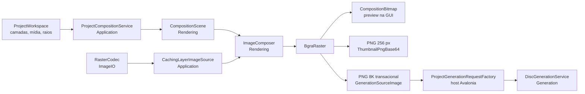

# Task 08 — Composição de imagem portátil

[← Anterior](07.project-lifecycle-and-home.md) · [Índice](00.index.md) · [Próxima →](09.design-workspace-and-undo-redo.md)

| Campo | Valor |
| --- | --- |
| Prioridade | P0 |
| Tipo sugerido | `refactor`, `feat` |
| Dependências | Tasks 01 e 02 |
| Resultado | Compositor determinístico sem WPF, reutilizado por preview/exportação |
| Situação | Concluída — Subtasks 08.1 a 08.5 implementadas; testes automatizados e goldens WPF pendentes |

## Objetivo

Substituir `DesignComposer`/`RenderTargetBitmap` por um pipeline `net10.0` independente de framework gráfico. O compositor deve produzir buffers raster previsíveis para thumbnail, preview e geração final, com consumo de memória controlado.

## Decisão técnica a registrar

Antes da implementação, comparar em um spike curto:

- SkiaSharp explícito em biblioteca portátil;
- composição gerenciada sobre buffers BGRA/RGBA;
- combinação do `DiscImageStudio.ImageIO` com rasterizador próprio.

Critérios: determinismo, transforms, alpha, qualidade de interpolação, cancelamento, suporte Linux, manutenção, licença, memória e facilidade de teste. Tipos Avalonia (`Bitmap`, `DrawingContext`) não podem ser o formato interno do motor.

## Escopo

- Biblioteca `DiscImageStudio.Rendering` ou namespace portátil equivalente.
- Modelo imutável de cena/camadas com posição, escala, rotação, opacidade, ordem e visibilidade.
- Decodificação limitada via `DiscImageStudio.ImageIO`.
- Composição transparente quadrada em resoluções 256, 2.048 e 8.192.
- Conversão explícita de espaço/canal e alpha premultiplicado quando necessário.
- Cache por revisão e política de descarte.
- Cancelamento em decode, transform e loops de composição.
- Adapter final para `Avalonia.Media.Imaging.Bitmap` somente na GUI.

## Plano de implementação

1. Congelar imagens golden geradas pela WPF para cenas representativas.
2. Definir coordenadas físicas e regras de arredondamento como contrato.
3. Implementar decode e transforms uma operação por vez.
4. Comparar pixel/perceptual com tolerância justificada.
5. Adicionar cache por revisão e evitar manter simultaneamente múltiplos buffers 8K.
6. Integrar thumbnail e preview; só então integrar geração final.
7. Medir tempo, peak working set e alocações.

## Contrato herdado da WPF

O compositor atual (`DiscImageStudio.App/Services/DesignComposer.cs`, ~100 linhas) define o comportamento que o motor portátil precisa reproduzir:

- **Canvas**: quadrado transparente cujo centro é o centro do disco e cujo lado vale `2 × canvasOuterRadiusMm`. Para CD o raio é o fixo do esquema (`CdDiscParameters.StandardImageOuterRadiusMm`); para DVD e BD é o raio externo gerado.
- **Tamanho físico da camada**: com escala 1, a maior dimensão da imagem ocupa o diâmetro do anel de conteúdo (`2 × ContentOuterRadiusMm`), preservando a proporção.
- **Transformação**: rotação em torno do centro da camada, seguida de translação em mm a partir do centro do disco, multiplicada por `pixelsPerMm = tamanho / (2 × canvasOuterRadiusMm)`.
- **Ordem**: `DesignState.Layers` é gravado de baixo para cima e o pintor percorre nessa ordem. Camadas invisíveis são ignoradas.
- **Decode**: limitado a 4.096 px de largura no carregamento. A saída é PNG `Pbgra32` nos tamanhos 256 (thumbnail), 2.048 (preview) e 8.192 (`RingImageQuality.GenerationSize`, geração).
- **Consumo**: a geração tipada recebe a composição por path (`GenerateDiscRequest.SourceImagePath`), então a composição final continua sendo um PNG temporário.

Duas lacunas afetam o escopo:

- **Opacidade**: o schema `.discproj` não tem opacidade por camada. O modelo de cena pode aceitá-la (padrão 1,0), mas persisti-la exige nova versão de schema e migração, o que fica fora desta task.
- **Imagens golden**: não há goldens da WPF versionadas. Gerá-las requer Windows; até lá, a comparação usa vetores de geometria determinísticos (centro, anel, cantos) e a tolerância visual fica pendente das goldens.

## Subtasks

1. **08.1 — Contrato de composição e decisão técnica (ADR)**: registrar como contrato as regras acima (coordenadas físicas, arredondamento, centro de pixel, ordem, canais e alpha premultiplicado interno com saída straight BGRA) e executar o spike curto entre SkiaSharp explícito, composição gerenciada sobre buffers BGRA e `ImageIO` com rasterizador próprio. Critérios: determinismo, interpolação, memória em 8K, cancelamento, licença e dependência nativa. Entregáveis: ADR com a escolha e a tolerância visual, cenas de referência descritas e, quando houver acesso a Windows, as goldens WPF congeladas.
2. **08.2 — Motor portátil de composição**: criar `DiscImageStudio.Rendering` (`net10.0`, sem WPF ou Avalonia) com modelo imutável de cena e camada (tamanho físico, translação, rotação, escala, visibilidade e opacidade opcional), decode limitado via `DiscImageStudio.ImageIO`, transformação por mapeamento inverso com a interpolação escolhida, cancelamento em decode, transformação e loops de composição, e saída `BgraRaster`/PNG. Inclui as regras de fronteira de dependência para o novo assembly.
3. **08.3 — Composição do projeto e cache por revisão**: serviço na camada `Application` que converte `ProjectWorkspace` em cena (paths relativos via `ProjectPaths`; assets ausentes ignorados e reportados, sem falhar a composição), com cache de imagens decodificadas por path, tamanho e data de modificação, e cache de composição por revisão e tamanho. A política de descarte nunca mantém dois buffers 8K ao mesmo tempo; um resultado de revisão antiga nunca substitui um mais novo; cancelamento não deixa cache parcialmente válido.
4. **08.4 — Thumbnail e preview na GUI Avalonia**: adapter `BgraRaster` → `Bitmap`/`WriteableBitmap` somente na GUI, preview de 2.048 px fora da thread de interface com descarte por revisão, e geração da thumbnail de 256 px ao salvar, preenchendo `ThumbnailPngBase64`. Isso fecha a lacuna da 07.4: projetos salvos na Avalonia passam a ter thumbnail própria nos recentes.
5. **08.5 — Composição final, geração e medição**: composição de 8.192 px gravada em PNG temporário de forma transacional e entregue ao pipeline tipado (`SourceImagePath`) para Exportação e Gravação, comparação com as referências e a tolerância da 08.1, e medição de tempo, pico de working set e alocações em 256, 2K e 8K, com o limite de memória documentado.

## Entrega 08.1

- A decisão técnica e o contrato estão em [IMAGE_COMPOSITION.md](../../IMAGE_COMPOSITION.md): composição gerenciada por mapeamento inverso sobre buffers BGRA, com decode e PNG pelo `DiscImageStudio.ImageIO`, sem dependência nativa nova.
- O spike comparou os dois motores no mesmo cenário. A composição gerenciada fez 8K em cerca de 600 ms com pico de 286 MiB; o SkiaSharp 3.119.4, em cerca de 2,5 s com 615 MiB. As saídas diferem em média 0,023 por canal (máximo 3), e ambas repetem o hash na mesma máquina.
- O contrato fixa coordenadas, centro de pixel, ordem, bordas suavizadas, alpha premultiplicado interno com saída straight, arredondamento `AwayFromZero`, pirâmide de redução, limites de memória e cancelamento.
- As seis cenas de referência e a tolerância proposta estão descritas. As goldens da WPF continuam pendentes de uma máquina Windows.

## Entrega 08.2

- Novo assembly `DiscImageStudio.Rendering` (`net10.0`), que só referencia `DiscImageStudio.ImageIO`. Está nas soluções `DiscImageStudio.slnx` e `DiscImageStudio.Linux.slnx` e nas listas de fronteira de dependência dos testes de arquitetura, que proíbem WPF e Avalonia.
- `CompositionScene`/`CompositionLayer` modelam a cena; `ImageComposer` implementa o contrato da 08.1 com mapeamento inverso bilinear, bordas suavizadas, *source-over* premultiplicado e conversão final para alpha straight no próprio buffer.
- `LayerImage` decodifica pelo `RasterCodec` dentro dos limites (256 MiB de arquivo, 64 Mpx de origem), reduz por média de área até 4.096 px no maior lado e constrói a pirâmide 2 × 2 só quando um destino menor precisa dela.
- O cancelamento é verificado no decode, na pirâmide e em cada faixa de linhas. Camadas ausentes, ilegíveis ou grandes demais viram `CompositionIssue`, e o resto da cena é composto.
- Verificação manual: a cena de referência composta em 2.048 px confere com o contrato (tamanho físico, eixos, rotação horária no centro da camada, ordem, invisível, opacidade e aviso de camada ausente). Uma imagem de 8.000 px com listras de 2 px reduzida a 256 px resulta em cinza uniforme, sem moiré. O 8K leva cerca de 840 ms com pico de 321 MiB.
- Testes automatizados de pixel, golden e benchmark (seção Testes) ficaram para depois, por decisão de priorização; o assembly ainda não tem cobertura automatizada.

## Entrega 08.3

- `DiscImageStudio.Application` passa a referenciar `DiscImageStudio.Rendering` (portátil, sem UI nem motores). O namespace `Application.Composition` contém `ProjectCompositionService` e `CachingLayerImageSource`.
- `ProjectCompositionService.CreateScene` converte `ProjectWorkspace` em cena com as regras da WPF. CD compõe contra o raio fixo do esquema, que o host injeta a partir de `CdDiscParameters`, para a camada de aplicação não depender dos motores; DVD e BD compõem contra o raio externo gerado. Paths relativos são resolvidos pela pasta do projeto, e assets ausentes viram `CompositionIssue` sem derrubar a composição.
- `CachingLayerImageSource` guarda imagens decodificadas por path normalizado, validadas por tamanho e data de modificação do arquivo, com descarte LRU acima de 384 MiB. Um decode cancelado ou com falha não deixa entrada no cache.
- O cache de composições guarda um resultado por tamanho, só até 2.048 px, chaveado pelo conteúdo da cena (incluindo a assinatura de cada arquivo). Uma composição de 8.192 px nunca fica retida pelo serviço, então não há dois buffers 8K vivos.
- `ComposeLatestAsync` trabalha por canal: um pedido novo cancela o anterior do mesmo canal, e o anterior devolve `null`. Assim, um resultado de revisão antiga nunca substitui um mais novo.

## Entrega 08.4

- `CompositionBitmap` é o único ponto que converte `BgraRaster` em `WriteableBitmap` (Bgra8888, alpha straight), e só existe na GUI.
- A página **Design** deixa de ser placeholder e mostra o preview da composição em 2.048 px, num palco de 440 px que encolhe em janelas estreitas. Anéis tracejados marcam a borda do canvas e o hub do disco (raio interno da mídia). Abaixo ficam o resumo ("1 of 3 visible layers composed…") e a lista de camadas ausentes, ilegíveis ou grandes demais, pelo nome. Um projeto sem camadas mostra estado vazio.
- O preview é recomposto ao abrir o projeto e a cada mudança persistente, como Apply nas configurações ou relink. Composição e conversão rodam fora da thread de interface, e o descarte por canal e por geração impede que um preview antigo substitua um mais novo. Fechar o projeto limpa o preview e os caches.
- Ao salvar, `ProjectLifecycleService` grava em `ThumbnailPngBase64` a composição de 256 px (`IProjectThumbnailRenderer`). Se nenhuma camada puder ser pintada, ou se a renderização falhar, a thumbnail anterior é mantida e o save segue. Com isso, projetos salvos na Avalonia passam a ter thumbnail própria nos recentes.
- Verificação manual por capturas nos temas claro e escuro, em janela larga e compacta: preview com camada presente e duas ausentes, estado vazio, e o card nos recentes trocando a thumbnail antiga pela composição após o save.

## Entrega 08.5

- `ProjectCompositionService.PrepareGenerationSource` compõe o projeto em 8.192 px e grava o PNG de forma transacional: primeiro num arquivo oculto `.partial`, renomeado para o nome final só depois da gravação completa. Falha ou cancelamento apagam o parcial, e o buffer de 8K é liberado antes do retorno. O resultado, `GenerationSourceImage`, é dono do arquivo e o apaga no `Dispose`; guarda só metadados (camadas pintadas e avisos).
- `ProjectGenerationRequestFactory` (no host, porque os tipos de request pertencem aos motores) converte o projeto tipado e o caminho da imagem em `GenerateCdRequest`, `GenerateDvdRequest` ou `GenerateBluRayRequest`, com as mesmas regras da WPF.
- `ProjectGenerationPreparer` junta as duas etapas e está registrado em `HostServices`, com imagens temporárias em `$XDG_CACHE_HOME/disc-image-studio/generation`. Exportação (Task 11) e Gravação (Task 13) vão consumir esse ponto de entrada.
- `RasterCodec.SavePngConsumingBuffer` grava o PNG de 8K reordenando os canais no próprio buffer, evitando uma cópia de 256 MiB.
- Verificação manual: o request de DVD preparado passa por `DiscGenerationService.PlanAsync`, o arquivo some no `Dispose`, e nem conclusão nem cancelamento deixam `.partial`. As cenas de referência 1 a 6 conferem com o contrato (detalhes no guia abaixo). As medições de 256 px, 2K e 8K estão no guia.

## Ordem de execução

08.1 vem antes de qualquer código, porque a escolha de biblioteca muda 08.2. 08.2 e 08.3 formam o motor e podem sair em PRs seguidos. 08.4 depende de 08.3 e é a primeira entrega visível. 08.5 fecha a task e libera a Task 11 (Exportação). A Task 09 (editor visual) pode começar após 08.4, usando o preview por revisão.

## Critérios de aceite

- Engine compila e testa em Linux sem WPF/Avalonia.
- Ordem, recorte, rotação, escala, opacidade e transparência são reproduzíveis.
- Centro e anel físico permanecem alinhados com a WPF dentro da tolerância definida.
- Composite 8K não duplica buffers desnecessariamente e respeita limite documentado.
- Resultado obsoleto por revisão nunca substitui preview mais novo.
- Cancelamento libera buffers/streams e não deixa cache parcialmente válido.

## Testes

- Pixel tests de camada única, múltiplas, alpha e bordas.
- Golden/similarity tests com imagens WPF existentes.
- Canais/byte order e alpha premultiplicado.
- Arquivos PNG/JPEG, dimensões extremas, EXIF orientation se suportada e input inválido.
- Concorrência de previews e cancelamento por revisão.
- Benchmark 256/2K/8K e teste de memória.

## Fora de escopo

- Interação do canvas Avalonia.
- Edição destrutiva de pixels.
- Alterar os algoritmos físicos CD/DVD/BD.

## Riscos

- Diferenças de interpolação são esperadas; definir tolerância visual e preservar geometria exata.
- SkiaSharp transitivo via Avalonia não deve ser assumido como contrato; referenciar/pinar explicitamente se escolhido.

## Guia completo da Task 08

Esta seção explica, do começo ao fim, o que a Task 08 entregou, como as peças se encaixam e como usá-las nas próximas tasks. Ela pode ser lida sem conhecer o código.

### 1. O problema

Um projeto do Disc Image Studio tem **camadas de imagem** (fotos, logotipos) posicionadas sobre o disco. Antes de gravar a arte no disco, essas camadas precisam virar **uma única imagem quadrada**, que os motores de CD, DVD e Blu-ray leem para decidir o padrão físico de cada setor. Essa etapa se chama **composição**.

Na aplicação WPF, a composição usava `DrawingVisual` e `RenderTargetBitmap`, recursos do Windows que exigem uma thread STA e não existem no Linux. A Task 08 substituiu essa peça por um motor portátil, sem dependência de framework gráfico, e o integrou ao app Linux em três usos:

| Uso | Tamanho | Para quê |
| --- | ---: | --- |
| Thumbnail | 256 px | imagem do projeto nos recentes, gravada no `.discproj` |
| Preview | 2.048 px | conferência visual na página Design |
| Geração | 8.192 px | imagem que os motores de disco leem |

### 2. Visão geral da arquitetura



Cada camada do código tem um papel e uma regra de dependência:

| Assembly | Papel na Task 08 | Pode depender de |
| --- | --- | --- |
| `DiscImageStudio.ImageIO` | ler e gravar PNG/JPEG/BMP/GIF como buffers BGRA | pacotes Stb (portátil) |
| `DiscImageStudio.Rendering` (novo) | motor de composição: cena, imagens preparadas, compositor | só `ImageIO` |
| `DiscImageStudio.Application` | converter o projeto em cena, cache, thumbnail, imagem de geração | `Core`, `Rendering` (nunca motores ou UI) |
| `DiscImageStudio.App.Avalonia` | preview na tela, montagem do request de geração | tudo acima, `Generation` e Avalonia |

A regra mais importante: **tipos do Avalonia nunca entram no motor**. O motor fala em `BgraRaster` (largura, altura, bytes BGRA); só a GUI converte isso em bitmap de tela, em um único ponto (`CompositionBitmap`).

### 3. Conceitos, do zero

**Canvas.** A imagem composta é um quadrado de `N × N` pixels com fundo transparente. O centro do quadrado é o centro do disco, e o lado representa `2 × raio do canvas` em milímetros. Em DVD e Blu-ray, o raio do canvas é o raio externo do projeto; em CD, é o raio fixo do esquema de imagem, 57,5 mm. O valor de CD mora no módulo de CD e é injetado pelo host, para a camada de aplicação não depender dos motores.

**Pixels por milímetro.** Toda posição do projeto está em milímetros. A conversão é `pixelsPerMm = N / (2 × raio do canvas)`. Com raio de 58 mm em 2.048 px, 1 mm ≈ 17,66 px.

**Tamanho físico da camada (regra de encaixe).** Com escala 1, o maior lado da imagem ocupa o diâmetro do anel de conteúdo (`2 × raio externo`), e o outro lado acompanha a proporção. Uma foto 4:3 em paisagem fica com toda a largura e 75% da altura.

**Transformação.** Cada camada gira em torno do próprio centro (graus, sentido horário na tela) e depois é deslocada em milímetros a partir do centro do disco, com x para a direita e y para baixo. A escala multiplica o tamanho físico.

**Mapeamento inverso.** Em vez de "empurrar" cada pixel da foto para o canvas, o motor percorre cada pixel do canvas e pergunta qual ponto da foto cai ali, aplicando a transformação ao contrário. Isso garante que todo pixel de destino seja preenchido exatamente uma vez, sem buracos, mesmo com rotação.

**Interpolação bilinear.** O ponto encontrado raramente cai no centro de um pixel da foto, então o motor faz a média ponderada dos quatro vizinhos. Coordenadas fora da foto são presas à borda.

**Bordas suavizadas.** Na borda de uma camada girada, a cobertura cai de 1 para 0 ao longo de 1 px. Sem isso, as bordas diagonais ficariam serrilhadas. A WPF faz algo equivalente.

**Alpha premultiplicado.** Uma imagem com transparência guarda, por pixel, cor e opacidade (alpha). Para combinar camadas sem halos escuros nas bordas, o motor trabalha internamente com a cor já multiplicada pelo alpha. A combinação usa a regra *source-over*: `resultado = camada + fundo × (1 − alpha da camada)`. No fim, a imagem é convertida de volta para alpha "straight", que é o que o PNG guarda.

**Pirâmide de redução.** Reduzir uma foto de 4.096 px para 256 px só com interpolação bilinear ignora a maior parte dos pixels e gera serrilhado e moiré. Por isso o motor monta, sob demanda, versões cada vez menores da imagem (cada uma com a média de blocos 2 × 2) e amostra da menor versão que ainda é maior que o destino. A pirâmide só é construída quando um destino pequeno precisa dela.

**Arredondamento determinístico.** Toda conversão para byte arredonda metades para longe do zero (`MidpointRounding.AwayFromZero`). Junto com a aritmética em `double`, isso faz o mesmo projeto gerar exatamente os mesmos bytes em qualquer processador.

### 4. O caminho de um pixel

1. O projeto aberto (`ProjectWorkspace`) chega ao `ProjectCompositionService`.
2. `CreateScene` calcula o raio do canvas, resolve paths relativos pela pasta do projeto e monta a `CompositionScene` com as camadas na ordem do arquivo (de baixo para cima).
3. Para cada camada visível, o `CachingLayerImageSource` devolve a imagem decodificada: do cache, se o arquivo não mudou, ou do disco via `RasterCodec`. Imagens maiores que 4.096 px são reduzidas por média de área já no carregamento.
4. Se uma imagem não existe, está corrompida ou excede os limites, a camada vira um `CompositionIssue` e as demais continuam.
5. O `ImageComposer` pinta cada camada no canvas, em paralelo por faixas de linhas, com mapeamento inverso, bilinear, borda suavizada e *source-over*.
6. O canvas é convertido para alpha straight no próprio buffer e devolvido como `BgraRaster`.
7. Conforme o uso, o resultado vira preview na tela, thumbnail PNG em Base64 ou PNG temporário de 8K para a geração.

### 5. As peças, uma a uma

**`CompositionScene` e `CompositionLayer` (Rendering).** Modelo imutável e validado: raios positivos, escala positiva, opacidade entre 0 e 1. A opacidade existe no motor, mas o `.discproj` ainda não a grava; o host passa 1.

**`LayerImage` (Rendering).** A imagem pronta para amostragem: premultiplicada, no máximo 4.096 px no maior lado, com a pirâmide construída sob demanda. É segura para uso simultâneo por composições concorrentes.

**`ImageComposer` (Rendering).** Implementa o contrato. Devolve `CompositionResult` com a imagem e os avisos, e cancela entre etapas e em cada faixa de linhas. Também expõe `BaseSizeMm`, a regra de encaixe, para quem precisar do tamanho físico de uma camada (por exemplo, o editor da Task 09).

**`CachingLayerImageSource` (Application).** Cache de imagens decodificadas. A chave é o path normalizado, validado pelo tamanho e pela data de modificação do arquivo: se o arquivo for trocado, ele é lido de novo. Acima de 384 MiB, as imagens menos usadas saem primeiro. Um decode cancelado ou com falha nunca entra no cache.

**`ProjectCompositionService` (Application).** O ponto de entrada:

- `Compose`: compõe de forma síncrona. Resultados de até 2.048 px ficam em cache, um por tamanho, chaveados pelo conteúdo da cena; uma composição de 8K nunca é retida.
- `ComposeLatestAsync(canal, …)`: para telas que recompõem várias vezes. Um pedido novo no mesmo canal cancela o anterior, que devolve `null`. Assim, um resultado antigo nunca substitui um mais novo.
- `RenderThumbnail`: PNG de 256 px em Base64, ou `null` quando nenhuma camada pôde ser pintada.
- `PrepareGenerationSource`: o PNG transacional de 8K para a geração.
- `Clear`: libera os caches, por exemplo ao fechar o projeto.

**`ProjectLifecycleService` (Application).** Ao salvar, pede a thumbnail ao renderizador. Se nada puder ser pintado ou a renderização falhar, mantém a thumbnail anterior e o save continua.

**`CompositionBitmap` e `CompositionPreviewViewModel` (GUI).** O preview da página Design compõe em 2.048 px fora da thread de interface, converte para bitmap e descarta resultados velhos por canal e por geração. Anéis tracejados marcam a borda do canvas e o hub do disco; camadas com problema aparecem pelo nome.

**`ProjectGenerationRequestFactory` e `ProjectGenerationPreparer` (host).** Convertem o projeto tipado no request de geração com as regras da WPF, apontando para a imagem de 8K preparada. Ficam no host porque os tipos de request pertencem aos motores.

### 6. Como usar nas próximas tasks

**Exportação (Task 11) e Gravação (Task 13):**

```csharp
ProjectGenerationPreparer preparer = hostServices.Generation;
using PreparedGeneration prepared = await preparer.PrepareAsync(
    projects.Current!,
    projects.ProjectFilePath,
    outputPath: "/home/user/disc.wav",
    cancellationToken: token);

if (prepared.Source.IsEmpty)
{
    // Nenhuma camada pôde ser pintada: avise antes de gerar um disco em branco.
}

GenerationPlan plan = await generation.PlanAsync(prepared.Request, token);
await generation.GenerateFileAsync(plan, outputPath, progress, token);
// Ao sair do using, a imagem temporária de 8K é apagada.
```

**Editor visual (Task 09):** use `ComposeLatestAsync` com um canal próprio (por exemplo `"design-editor"`) a cada mudança de camada, e `ImageComposer.BaseSizeMm` para desenhar alças e caixas no tamanho físico correto. Quando a edição for persistida via `ReplaceWorkspace`, o preview atual é recomposto sozinho.

**Novas telas de preview:** nunca converta `BgraRaster` em bitmap por conta própria; use `CompositionBitmap.ToBitmap`, sempre fora da thread de interface.

### 7. Verificação feita

Por decisão de priorização, nenhum teste automatizado foi escrito nesta task. A verificação foi manual, com programas descartáveis e capturas da interface:

| Verificação | Resultado |
| --- | --- |
| Cena 1: paisagem, escala 1 | retângulo exato, erro 0 px |
| Cena 2: retrato deslocado (+10, −6) mm | erro máximo 0,45 px |
| Cena 3: rotação de 30° com escala 0,5 | erro máximo 0,41 px |
| Cena 4: camada semitransparente sobre opaca | cor do centro exatamente a esperada |
| Cena 5: camada invisível | não aparece (alpha 0) |
| Cena 6: listras de 8.000 px reduzidas a 256 px | cinza uniforme, desvio padrão 2,65, sem moiré |
| Request de DVD preparado | aceito por `PlanAsync` |
| Arquivos temporários | apagados no `Dispose`; nenhum `.partial` após conclusão ou cancelamento |
| Preview e thumbnail | conferidos por capturas nos temas claro e escuro, em janela larga e compacta |

As cenas 1 a 6 são as cenas de referência de [IMAGE_COMPOSITION.md](../../IMAGE_COMPOSITION.md), comparadas com valores calculados a partir do contrato. A comparação pixel a pixel com a WPF ainda depende das goldens, que exigem Windows.

### 8. Desempenho e memória medidos

Máquina de 12 núcleos, Release, cada linha em processo próprio. A cena tem uma foto de 4.096 × 3.072 e uma camada de 2.048 px girada com alpha, lidas de PNG.

| Operação | Tempo | Pico de working set | Bytes alocados |
| --- | ---: | ---: | ---: |
| Composição 256 px | 289 ms | 331 MiB | 151 MiB |
| Composição 2.048 px | 321 ms | 199 MiB | 161 MiB |
| Composição 8.192 px | 653 ms | 423 MiB | 385 MiB |
| Imagem de geração (8K + PNG) | 6,3 s | 690 MiB | 392 MiB |

Como ler esses números:

- Em 256 e 2.048 px, quase todo o custo é decodificar as fotos de origem (um PNG de 4.096 × 3.072 vira 48 MiB em memória, duas vezes: straight e premultiplicado). Com o cache, recompor o preview do mesmo projeto não decodifica de novo.
- O pico de 256 px é maior que o de 2.048 px porque a redução da foto para 256 px constrói a pirâmide (2.048, 1.024 e 512 px) antes de amostrar.
- Na geração, a composição de 8K leva menos de 1 s. O restante (≈5,6 s e ≈270 MiB temporários) é a codificação PNG do StbImageWriteSharp, que filtra e comprime a imagem inteira em memória.

**Limite de memória documentado:** composição de 8K ≈ 430 MiB; preparação da imagem de geração ≈ 700 MiB de pico. Hosts devem reservar 768 MiB para essa etapa.

### 9. Critérios de aceite

| Critério | Situação |
| --- | --- |
| Engine compila em Linux sem WPF/Avalonia | atendido: `DiscImageStudio.Rendering` só referencia `ImageIO`, e está nas regras de fronteira |
| Engine testa em Linux | pendente: testes automatizados adiados por priorização |
| Ordem, recorte, rotação, escala, opacidade e transparência reproduzíveis | atendido na verificação manual (cenas 1 a 5) e determinístico por construção |
| Centro e anel alinhados com a WPF dentro da tolerância | geometria atende ao contrato (≤ 0,45 px); comparação com a WPF pendente das goldens |
| Composite 8K sem buffers duplicados e com limite documentado | atendido: conversão final no próprio buffer, 8K nunca em cache, PNG sem cópia extra; limite na seção 8 |
| Resultado obsoleto nunca substitui preview mais novo | atendido: descarte por canal (serviço) e por geração (view model) |
| Cancelamento libera recursos e não deixa cache parcial | atendido: cache só recebe resultados completos; o `.partial` é apagado |

### 10. Pendências e próximos passos

- **Goldens da WPF:** gerar no Windows os PNGs das seis cenas de referência e confirmar a tolerância proposta.
- **Testes automatizados:** pixel tests, goldens e benchmark da seção Testes, quando a priorização permitir.
- **Codificação do PNG de 8K:** é a etapa mais lenta e mais pesada da geração. Opções para a Task 11 ou 17: entregar o raster ao pipeline sem passar por arquivo, usar um formato sem compressão para o arquivo temporário, ou reduzir o nível de compressão.
- **Opacidade por camada:** o motor já suporta, mas persistir exige nova versão do schema do `.discproj`.
- **Codec do Windows:** as mudanças de `WritePng` (stream e buffer consumível) são mecânicas, mas só compilam no Windows; validar na próxima build Windows.

### 11. Onde está cada coisa

| Arquivo | Conteúdo |
| --- | --- |
| [IMAGE_COMPOSITION.md](../../IMAGE_COMPOSITION.md) | decisão (ADR), contrato de geometria e de pixel, limites, cenas de referência |
| `src/DiscImageStudio.Rendering/CompositionScene.cs` | modelo de cena e camada |
| `src/DiscImageStudio.Rendering/LayerImage.cs` | imagem preparada e pirâmide |
| `src/DiscImageStudio.Rendering/AreaResampler.cs` | redução por média de área no carregamento |
| `src/DiscImageStudio.Rendering/ImageComposer.cs` | compositor, avisos e gravação PNG |
| `src/DiscImageStudio.Rendering/CompositionLimits.cs` | limites de tamanho e memória |
| `src/DiscImageStudio.Application/Composition/CachingLayerImageSource.cs` | cache de imagens decodificadas |
| `src/DiscImageStudio.Application/Composition/ProjectCompositionService.cs` | projeto → cena, cache, canais, thumbnail, imagem de geração |
| `src/DiscImageStudio.Application/Composition/GenerationSourceImage.cs` | arquivo temporário de 8K |
| `src/DiscImageStudio.App.Avalonia/Platform/CompositionBitmap.cs` | conversão para bitmap do Avalonia |
| `src/DiscImageStudio.App.Avalonia/ViewModels/CompositionPreviewViewModel.cs` | preview da página Design |
| `src/DiscImageStudio.App.Avalonia/Generation/` | request de geração e preparador |
| `src/DiscImageStudio.ImageIO/RasterCodec.cs` | `EncodePng` e `SavePngConsumingBuffer` |

---

[← Anterior](07.project-lifecycle-and-home.md) · [Índice](00.index.md) · [Próxima →](09.design-workspace-and-undo-redo.md)
